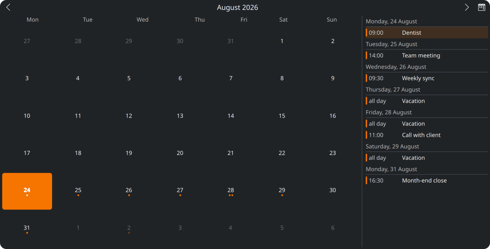

# caldaver

A Plasma 6 widget that keeps the events of a CalDAV calendar permanently on the KDE
desktop — the month grid with colored event dots on the left, a continuous agenda column
with every event of the month on the right. The whole month at a glance, without a click.



## How it works

```
CalDAV server ──CalDAV──▶ akonadi_davgroupware_resource     password in KWallet
                                    │
                           pimevents.so                      Plasma calendar plugin
                                    │
                           EventPluginsManager
                                    │
                              caldaver
```

Akonadi, the PIM backend of KDE, handles the connection to the server. That covers
authentication, synchronization, time zones and the expansion of recurring events
(`RRULE`/`EXDATE`) without the widget having to deal with any of it.

In concrete terms:

* caldaver parses **no** ICS and does **not** talk to the server itself.
* It stores **no** password — the credentials live in KWallet.
* The same calendar is available to KOrganizer and Merkuro as well.
* The widget is pure QML. No compiler, no build dependencies.

## Requirements

| Package | What for |
|---|---|
| Plasma 6.4 or newer | runtime environment |
| `kdepim-runtime` | provides `akonadi_davgroupware_resource` |
| `kdepim-addons` | provides the calendar plugin `pimevents.so` |
| `akonadi-server` | has to be running (`akonadictl status`) |
| `korganizer` | for setting up the CalDAV account |

On Fedora:

```bash
sudo dnf install kdepim-runtime kdepim-addons korganizer
```

## Installation

```bash
git clone https://github.com/websoftmz/caldaver.git
cd caldaver
kpackagetool6 --type Plasma/Applet --install .
```

The package ends up in `~/.local/share/plasma/plasmoids/de.websoftmz.caldaver/`.

Plasma addresses the package by its applet id `de.websoftmz.caldaver`; that id is what
`kpackagetool6` and the journal messages use, while the widget list shows it as
“caldaver”.

Then right-click the desktop → **Add Widgets…** → drag "caldaver" onto
the desktop and pull it to the size you want. About 1000 × 550 pixels is a good starting
point. Finally right-click the desktop → **Lock Widgets** so nothing slips out of place.

### Updating

```bash
git pull
kpackagetool6 --type Plasma/Applet --upgrade .
kquitapp6 plasmashell && (nohup plasmashell > /dev/null 2>&1 &)
```

Restarting the shell is necessary because Plasma caches QML.

### Uninstalling

```bash
kpackagetool6 --type Plasma/Applet --remove de.websoftmz.caldaver
```

## Setting up the calendar

The widget shows what Akonadi knows about, so the calendar has to be registered once as a
CalDAV account:

1. Start **KOrganizer**.
2. **Settings → Configure KOrganizer → Calendars → Add…**
3. Pick **DAV groupware resource**.
4. Choose **"Configure this service manually"** — no provider preset.
5. Server type **CalDAV**, then enter the calendar URL, for example
   `https://<server>/<user>/<calendar-id>/`
6. Enter user name and password and tick **"Store password"**. The credentials end up in
   KWallet.
7. **"Test connection"**, then finish.

If the wizard rejects the calendar URL because principal discovery fails: give only the
user URL `https://<server>/<user>/` instead and pick the calendar from the list it offers.

As soon as KOrganizer shows the events, go to the widget: right-click →
**Configure caldaver… → Calendars** → tick the calendar.

> With Radicale the path scheme is `/<user>/<calendar-id>/`, so the user name is already
> part of the URL.

## Settings

Right-click the widget → **Configure caldaver…**

### Calendars

Selects which of the calendars known to Akonadi are shown. Changes take effect right away.

### Appearance

| Option | Default | Effect |
|---|---|---|
| Accent color | `#f67400` | Color of the event dots, the agenda bars and the today marker. Free color choice plus six quick-pick swatches. |
| Use the color of each calendar instead | off | Takes the color of the respective calendar instead of the accent color. Useful once there is more than one calendar. |
| Show week numbers | off | Adds a week number column on the left. |
| Dim past events | on | Events that are already over are dimmed. |
| Hide past events completely | off | The agenda starts at the next upcoming event. |
| Width of the agenda column | 280 px | |
| Draw the Plasma background | on | Turned off, the widget floats on the wallpaper without a tile. |

The accent color defaults to orange because the standard blue of Plasma is hard to make
out on the dark widget background.

## Usage

* **`‹` / `›`** — one month back or forward.
* **Calendar button** at the top right — back to the current month.
* **Click on a day** — the agenda jumps to the first event of that day.
* **Pointer over a day** — shows the number of events.
* **Pointer over an agenda entry** — shows the time span and the description.

New or changed events appear automatically as soon as Akonadi knows about them — no
restart needed. At midnight the today marker moves on by itself.

## Troubleshooting

Live messages from the widget:

```bash
journalctl --user -f | grep caldaver
```

On startup caldaver logs every calendar plugin it found, with its identifier.

| Symptom | Cause and remedy |
|---|---|
| Widget stays empty although KOrganizer shows events | The calendar is not ticked → configure widget → Calendars |
| KOrganizer shows nothing either | The DAV resource is misconfigured → redo the setup, try the alternative user URL |
| Event dots barely visible | Pick a lighter accent color |
| Changes to the code have no effect | `--upgrade` forgotten, plasmashell not restarted, or `rm -rf ~/.cache/qmlcache` needed |
| Widget collapses into an icon | The widget was dropped into a panel instead of onto the desktop |

Desktop widgets always sit below the windows. To keep the calendar permanently visible,
use "Show Desktop" (Meta+D) or a KWin window rule — that is not the widget's job.

## Development

```bash
kpackagetool6 --type Plasma/Applet --upgrade .
kquitapp6 plasmashell && (nohup plasmashell > /dev/null 2>&1 &)
journalctl --user -f | grep caldaver
```

## Configuration files

| File | Contents |
|---|---|
| `~/.config/plasma-org.kde.plasma.desktop-appletsrc` | position, size and options of the widget |
| `~/.config/plasmashellrc`, group `[PIMEventsPlugin]` | which Akonadi calendars are shown |
| KWallet | the CalDAV credentials |

## License

MIT — see [LICENSE.md](LICENSE.md).

## Author

websoftmz
